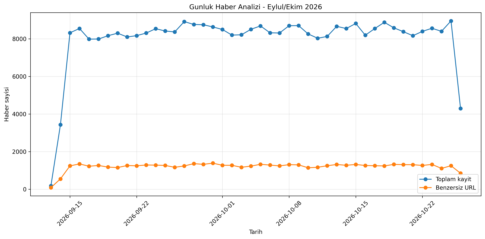
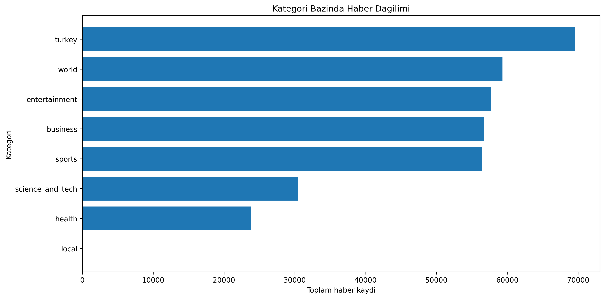
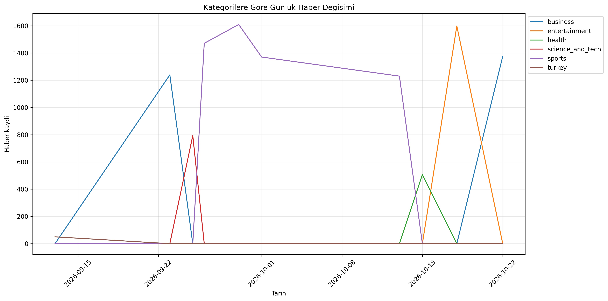
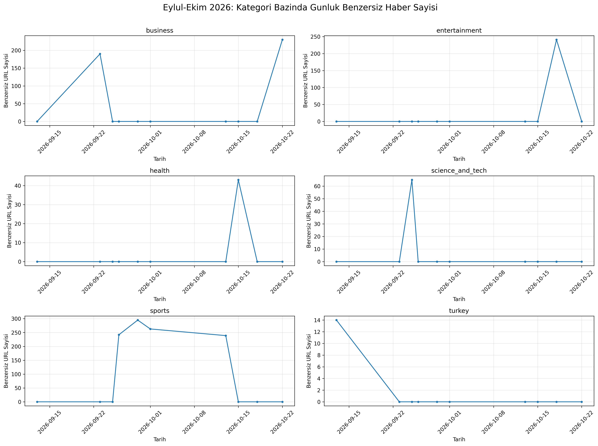
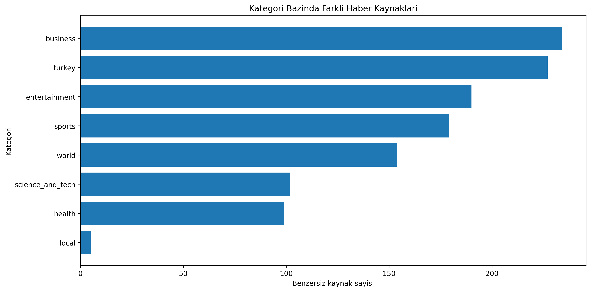

## 1. Giriş

Bu aşamada, DFCP projesinde kullanılan Amazon RDS altyapısından Amazon S3 ve Amazon Athena tabanlı sunucusuz bir veri analiz mimarisine geçilmiştir.

Önceden S3 üzerinde JSON formatında saklanan haber verileri, Athena ile sorgulanmaya uygun JSONL formatına dönüştürülmüştür. AWS Lambda güncellenerek yeni haberlerin doğrudan JSONL formatında S3'e kaydedilmesi sağlanmıştır.

AWS Glue Data Catalog üzerinde veri tabanı ve tablo oluşturulmuş, Partition Projection özelliği etkinleştirilerek yeni verilerin manuel partition kaydı gerektirmeden sorgulanabilmesi sağlanmıştır.

Amazon Athena üzerinde haber verilerini analiz etmek amacıyla SQL View oluşturulmuştur. Bu View'lar üzerinden günlük haber sayıları, kategori dağılımları, benzersiz URL sayıları ve haber kaynakları incelenmiştir.

Son olarak sorgu sonuçları CSV formatında indirilmiş, Python'un Pandas ve Matplotlib kütüphaneleri kullanılarak görselleştirilmiş ve PNG dosyaları olarak kaydedilmiştir.

Böylece veri toplama, depolama, sorgulama ve görselleştirme süreçlerini kapsayan AWS tabanlı bir veri analiz altyapısı oluşturulmuştur.
## 2. RDS'den Amazon Athena'ya Geçiş

Projenin önceki mimarisinde haber verilerinin saklanması için Amazon RDS kullanılmıştır. Ancak sürekli çalışan bir veritabanı yerine, verilerin Amazon S3 üzerinde saklandığı ve ihtiyaç duyulduğunda Amazon Athena ile sorgulandığı bir mimariye geçilmiştir.

Bu geçiş kapsamında aşağıdaki işlemler gerçekleştirilmiştir:

1. `data-fellow-athena-news` isimli yeni bir S3 bucket oluşturulmuştur.
2. Eski S3 bucket'ındaki JSON dosyaları Python kullanılarak JSONL formatına dönüştürülmüştür.
3. Dönüştürülen veriler yeni bucket'a aktarılmıştır.
4. Lambda fonksiyonu güncellenerek yeni haberlerin doğrudan JSONL formatında kaydedilmesi sağlanmıştır.
5. AWS Glue Data Catalog üzerinde `data_fellow_db` veritabanı ve `news_articles` tablosu oluşturulmuştur.
6. Amazon Athena ile verilerin SQL sorguları üzerinden erişilebilir olduğu doğrulanmıştır.
7. Partition Projection etkinleştirilerek yeni tarih klasörleri için manuel partition kaydı gereksinimi kaldırılmıştır.

Bu işlemlerin sonucunda, haberlerin depolanması ve analiz edilmesi için RDS kullanımına gerek kalmamıştır.

## 3. Sistem Mimarisi ve Kullanılan AWS Servisleri

Sistemin veri akışı aşağıdaki gibidir:

```text
Google News RSS
      |
      v
EventBridge Scheduler
      |
      v
AWS Lambda
      |
      v
Amazon S3
      |
      v
AWS Glue Data Catalog
      |
      v
Amazon Athena
```
### 3.1. Kullanılan AWS Servisleri

**Amazon EventBridge Scheduler:** Google News RSS verilerinin
düzenli olarak toplanması için AWS Lambda fonksiyonunu
saatlik olarak tetikler.

**AWS Lambda:** Python ile geliştirilen haber toplama kodunu
çalıştırır. Elde edilen haberleri JSONL formatında Amazon S3'e
kaydeder.

**Amazon S3:** Haber verilerini kalıcı olarak depolar.
`data-fellow-athena-news` bucket'ı içerisinde haberler `news/`,
Athena sorgu sonuçları ise `athena-results/` prefix'inde tutulur.


### 3.2. AWS Glue Data Catalog

AWS Glue Data Catalog, verilerin konumlarını, tablo
şemalarını ve metadata bilgilerini yöneten bir
veri kataloğu hizmetidir.

Metadata; verilerin sütun adları, veri tipleri,
bulunduğu S3 konumu ve partition bilgileri gibi
tanımlayıcı bilgileri ifade eder.

DFCP projesinde Glue Data Catalog üzerinde:

- `data_fellow_db` isimli veritabanı oluşturulmuştur.
- `news_articles` isimli tablo tanımlanmıştır.
- Haberlerin sütunları ve veri tipleri belirlenmiştir.
- S3 üzerindeki verilerin konumu tabloya tanıtılmıştır.

Glue Data Catalog haber dosyalarının kendisini
saklamaz. Haberler Amazon S3 üzerinde bulunurken
Glue, bu verilerin nasıl okunacağını tanımlayan
metadata bilgilerini tutar.

### 3.3. Amazon Athena

Amazon Athena, Amazon S3 üzerinde saklanan verilerin
SQL kullanılarak analiz edilmesini sağlayan
sunucusuz bir sorgulama hizmetidir.

Athena sayesinde veriler, ilişkisel bir veritabanına
aktarılmadan doğrudan S3 üzerinden sorgulanabilir.

DFCP projesinde Athena kullanılarak:

- Haberlerin toplam kayıt sayıları hesaplanmıştır.
- Kategori ve tarih bazlı analizler yapılmıştır.
- Benzersiz haber URL'leri incelenmiştir.
- Haber kaynaklarının dağılımı analiz edilmiştir.
- Tekrar kullanılabilir SQL View'lar oluşturulmuştur.

Sorgu sonuçları, S3 üzerindeki `athena-results/`
prefix'ine kaydedilmiştir.

### 3.4. Glue Data Catalog ve Athena'nın Birlikte Çalışması

Glue Data Catalog, Athena'ya verilerin yapısını
ve S3 üzerinde nerede bulunduğunu bildirir.

Athena ise bu bilgileri kullanarak ilgili JSONL
dosyalarını okur ve SQL sorgularını çalıştırır.

Bu iki hizmetin birlikte kullanılması sayesinde
haber verilerini RDS gibi sürekli çalışan bir
veritabanı sunucusuna ihtiyaç duymadan
analiz edebiliyoruz.

## 4. Veri Depolama ve Dönüştürme

### 4.1. JSON'dan JSONL Formatına Geçiş

DFCP projesinde haber verileri başlangıçta
`data-fellow-crawler-project` isimli S3 bucket'ında
JSON formatında saklanmaktaydı.

Amazon Athena ile uyumlu bir veri yapısı oluşturmak
amacıyla Python kullanılarak JSON dosyaları JSONL
(JSON Lines) formatına dönüştürülmüştür.

JSON formatında haber kayıtları tek bir dizi içerisinde
tutulurken, JSONL formatında her haber ayrı bir satırda
JSON nesnesi olarak saklanmaktadır.

**JSON örneği:**

```json
[
  {"title": "Haber A", "source": "Kaynak A"},
  {"title": "Haber B", "source": "Kaynak B"}
]
```

**JSONL örneği:**

```json
{"title": "Haber A", "source": "Kaynak A"}
{"title": "Haber B", "source": "Kaynak B"}
```

Bu dönüşüm için geliştirilen Python scripti eski S3
bucket'ındaki JSON dosyalarını okuyarak JSONL
formatında yeni bucket'a aktarmıştır.

### 4.2. Amazon S3 Depolama Yapısı

Dönüştürülen veriler `data-fellow-athena-news`
isimli S3 bucket'ına kaydedilmiştir.

Veriler kategori ve tarihe göre Hive uyumlu
partition yapısında düzenlenmiştir:

```text
news/
  category=sports/
    year=2026/
      month=10/
        day=20/
          00-06.jsonl
```

Bu yapıda:

- `category`: Haber kategorisi
- `year`: Verinin toplandığı yıl
- `month`: Verinin toplandığı ay
- `day`: Verinin toplandığı gün

Bucket içerisinde iki temel prefix bulunmaktadır:

- `news/`: Haber verilerinin saklandığı alan.
- `athena-results/`: Athena SQL sorgularının
  sonuç dosyalarının saklandığı alan.

### 4.3. AWS Lambda'nın Güncellenmesi

Mevcut AWS Lambda fonksiyonu, haberleri JSON dizisi
yerine JSONL formatında kaydedecek şekilde
güncellenmiştir.

Lambda, EventBridge Scheduler tarafından saatlik
olarak tetiklenmekte ve Google News RSS kaynaklarından
topladığı haberleri ilgili kategori ve tarih
partition'larına kaydetmektedir.

Böylece yeni haberler için ayrıca bir JSONL
dönüştürme işlemi gerekmemektedir.

### 4.4. Partition Projection

Verilerin Athena üzerinden verimli biçimde
sorgulanabilmesi için kategori ve tarih alanlarına
göre partition yapısı kullanılmıştır.

Başlangıçta mevcut partition'lar aşağıdaki komutla
Glue Data Catalog'a kaydedilmiştir:

```sql
MSCK REPAIR TABLE data_fellow_db.news_articles;
```

Ancak yeni tarih klasörleri oluşturuldukça
bu komutun tekrar çalıştırılması gerekecekti.

Bu nedenle Athena üzerinde **Partition Projection**
özelliği etkinleştirilmiştir.

Partition Projection, kategori ve tarih değerlerinden
S3 klasör konumlarını hesaplayarak yeni partition'ların
manuel olarak kaydedilmesi ihtiyacını ortadan kaldırır.

Bu yapı sayesinde Lambda'nın yeni günlerde oluşturduğu
JSONL dosyaları, Athena üzerinden ilgili partition
filtreleriyle sorgulanabilmektedir.


## 5. Amazon Athena ile Veri Analizi

Amazon Athena üzerinde Eylül–Ekim 2026 dönemine ait haber
verilerini analiz etmek amacıyla SQL View'lar oluşturulmuştur.

Analizlerde toplam haber kayıtları, benzersiz URL sayıları,
kategori dağılımları ve haber kaynakları incelenmiştir.

### 5.1. Günlük Haber Analizi

Bu analizde, her gün toplanan toplam haber sayısı ile
benzersiz URL sayısı karşılaştırılmıştır.

**SQL Sorgusu:**

```sql
CREATE OR REPLACE VIEW data_fellow_db.vw_daily_news AS
SELECT
    year,
    month,
    day,
    COUNT(*) AS record_count,
    COUNT(DISTINCT url) AS distinct_url_count
FROM data_fellow_db.news_articles
WHERE year = '2026'
  AND month IN ('09', '10')
GROUP BY year, month, day;
```

- `COUNT(*)`: Tekrarlananlar dahil toplam kayıt sayısıdır.
- `COUNT(DISTINCT url)`: Farklı URL sayısını hesaplar.
- `WHERE`: Eylül ve Ekim 2026 verilerini seçer.
- `GROUP BY`: Kayıtları toplama gününe göre gruplandırır.

**Grafik:**



**Sonuç ve Değerlendirme:**

Grafik, toplam haber kaydı ile benzersiz URL sayısının
günlük değişimini karşılaştırmaktadır.

Bu iki değer arasındaki fark, aynı gün içinde tekrar
toplanan URL kayıtlarını ortaya koymaktadır.

Saatlik RSS toplama sisteminde aynı haberin farklı
saatlerde yeniden elde edilmesi mümkündür.

Bu nedenle sistemin topladığı kayıt miktarını
değerlendirirken yalnızca toplam kayıt sayısı değil,
benzersiz URL sayısı da dikkate alınmalıdır.

### 5.2. Kategorilere Göre Haber Dağılımı

Bu analizde, haberlerin kategorilere göre dağılımı
incelenmiştir.

**SQL Sorgusu:**

```sql
CREATE OR REPLACE VIEW data_fellow_db.vw_category_distribution AS
SELECT
    category,
    COUNT(*) AS record_count,
    COUNT(DISTINCT url) AS distinct_url_count
FROM data_fellow_db.news_articles
WHERE year = '2026'
  AND month IN ('09', '10')
GROUP BY category;
```
- `category`: Haber kategorisidir.
- `COUNT(*)`: Kategorideki toplam kayıt sayısıdır.
- `COUNT(DISTINCT url)`: Kategorideki farklı URL sayısıdır.
- `GROUP BY category`: Haberleri kategori bazında gruplandırır.

**Grafik:**



**Sonuç ve Değerlendirme:**

Kategori dağılımı, veri setinde hangi haber türlerinin
daha fazla temsil edildiğini göstermektedir.

Kategoriler arasında kayıt sayısı bakımından
farklılıklar bulunması, toplanan RSS içeriklerinin
kategoriye göre eşit dağılmadığını gösterir.

Bununla birlikte yüksek kayıt sayısı, her zaman
daha fazla benzersiz haber bulunduğu anlamına gelmez.

Bu nedenle kategoriler karşılaştırılırken toplam kayıt
sayısının yanında benzersiz URL sayısı da incelenmelidir.

### 5.3. Haber Kaynaklarının Analizi

Bu analizde, veri setine en fazla haber sağlayan
kaynakların belirlenmesi amaçlanmıştır.

**SQL Sorgusu:**

```sql
CREATE OR REPLACE VIEW data_fellow_db.vw_top_sources AS
SELECT
    source,
    COUNT(*) AS record_count,
    COUNT(DISTINCT url) AS distinct_url_count
FROM data_fellow_db.news_articles
WHERE year = '2026'
  AND month IN ('09', '10')
  AND source IS NOT NULL
  AND TRIM(source) <> ''
GROUP BY source;
```

- `source`: Haberin kaynak bilgisidir.
- `COUNT(*)`: Kaynağa ait toplam kayıt sayısıdır.
- `COUNT(DISTINCT url)`: Kaynağa ait benzersiz URL sayısıdır.
- `TRIM(source) <> ''`: Kaynak adı boş olan kayıtları dışlar.

**Sonuç ve Değerlendirme:**

Grafik, haber kaynaklarının DFCP veri setindeki
temsil düzeylerini karşılaştırmaktadır.

Benzersiz URL sayısı üzerinden yapılan değerlendirme,
aynı haberin tekrar toplanmasının etkisini azaltır.

Bu analiz, belirli kaynakların veri setinde ne kadar
ağırlığa sahip olduğunu incelemek için kullanılabilir.

Ancak sonuçlar haber kaynaklarının güvenilirliğini
veya yayımladıkları tüm haberlerin miktarını göstermez.

### 5.4. Günlük Kategori Bazında Haber Analizi

Bu analizde, Eylül–Ekim 2026 döneminde her kategoride günlük toplanan toplam haber kayıtları ve benzersiz URL sayıları incelenmiştir.

**SQL Sorgusu:**

```sql
CREATE OR REPLACE VIEW data_fellow_db.vw_daily_category AS
SELECT
    year,
    month,
    day,
    category,
    COUNT(*) AS record_count,
    COUNT(DISTINCT url) AS distinct_url_count
FROM data_fellow_db.news_articles
WHERE year = '2026'
  AND month IN ('09', '10')
GROUP BY year, month, day, category;
```

**Sorgunun Açıklaması:**

- `year`, `month`, `day`: Verilerin toplandığı tarihi belirtir.
- `category`: Haber kategorisini gösterir.
- `COUNT(*)`: Günlük toplam kayıt sayısını hesaplar.
- `COUNT(DISTINCT url)`: Aynı gün ve kategorideki farklı URL sayısını hesaplar.
- `GROUP BY`: Haberleri tarih ve kategoriye göre gruplandırır.

#### 5.4.1. Kategorilerin Günlük Haber Değişimi

İlk grafikte, kategorilerdeki günlük toplam haber kayıtlarının değişimi karşılaştırılmıştır.

**Grafik:**



**Sonuç ve Değerlendirme:**

Bu grafik, farklı kategorilerde toplanan haber kayıtlarının günlere göre nasıl değiştiğini incelemek amacıyla hazırlanmıştır.

Kategorilerin aynı grafik üzerinde gösterilmesi, günlük kayıt miktarlarının karşılaştırılmasını sağlamaktadır. Ancak toplam kayıt sayıları, saatlik veri toplama nedeniyle tekrar eden URL'leri de içermektedir.

#### 5.4.2. Kategorilere Göre Günlük Benzersiz Haber Analizi

İkinci görselleştirmede, aynı SQL View'ın `distinct_url_count` sütunu kullanılarak her kategorinin günlük benzersiz URL sayısı ayrı panellerde gösterilmiştir.

Veriler Python'da Pandas kütüphanesi kullanılarak aşağıdaki şekilde düzenlenmiştir:

```python
pivot = df.pivot_table(
    index="date",
    columns="category",
    values="distinct_url_count",
    aggfunc="sum",
    fill_value=0
)
```

**Kodun Açıklaması:**

- `index="date"`: Verileri tarihe göre düzenler.
- `columns="category"`: Kategorileri ayrı sütunlara ayırır.
- `values="distinct_url_count"`: Günlük benzersiz URL sayılarını kullanır.
- `fill_value=0`: Eksik tarih-kategori kombinasyonlarını grafik için sıfırla doldurur.

**Grafik:**



**Sonuç ve Değerlendirme:**

Her kategorinin ayrı panelde gösterilmesi, günlük değişimlerin daha kolay incelenmesini sağlamıştır.

Benzersiz URL sayısının kullanılmasıyla aynı gün ve kategoride tekrar toplanan haberlerin sayım üzerindeki etkisi giderilmiştir.

Bununla birlikte benzersizlik günlük olarak hesaplandığından, aynı URL farklı günlerde yeniden toplandığında her günün sayısına ayrı ayrı dahil edilmektedir.

Bu iki grafik birlikte değerlendirildiğinde, kategorilerin günlük toplam kayıt hacmi ile benzersiz URL sayıları arasındaki fark incelenebilmektedir.

### 5.6. Haber Kaynaklarının Çeşitliliği

Bu analizde, her kategoride kaç farklı haber
kaynağı bulunduğu araştırılmıştır.

**SQL Sorgusu:**

```sql
CREATE OR REPLACE VIEW data_fellow_db.vw_source_diversity AS
SELECT
    category,
    COUNT(*) AS record_count,
    COUNT(DISTINCT source) AS distinct_sources,
    COUNT(DISTINCT url) AS distinct_urls
FROM data_fellow_db.news_articles
WHERE year = '2026'
  AND month IN ('09', '10')
GROUP BY category;
```

**Sorgunun Açıklaması:**

- `COUNT(*)`: Toplam kayıt sayısını hesaplar.
- `COUNT(DISTINCT source)`: Farklı kaynak sayısını hesaplar.
- `COUNT(DISTINCT url)`: Benzersiz URL sayısını hesaplar.
- `GROUP BY category`: Sonuçları kategoriye göre gruplandırır.

**Grafik:**



**Sonuç ve Değerlendirme:**

Grafik, her kategoride veri elde edilen farklı
haber kaynaklarının sayısını göstermektedir.

Kaynak sayısı fazla olan kategorilerde veri setinin
daha geniş bir yayıncı çeşitliliğini kapsadığı
görülmektedir.

Ancak kaynak sayısı tek başına dağılımın dengeli
olduğunu göstermez. Çok sayıda kaynak bulunmasına
rağmen haberlerin büyük bölümü birkaç kaynaktan
geliyor olabilir.

Bu nedenle kaynak çeşitliliği ile kaynakların
haber sayıları birlikte değerlendirilmelidir.


### 5.7. AWS Maliyet Analizi

Bu bölümde Amazon Athena ve AWS Glue Data Catalog
servislerinin tahmini maliyetleri, AWS'nin resmî
fiyatlandırma bilgileri esas alınarak hesaplanmıştır.

#### 5.7.1. Amazon Athena Maliyeti

Amazon Athena, SQL sorgularında taranan veri miktarına
göre ücretlendirilmektedir. Standart SQL sorguları
için birim fiyat yaklaşık 5 USD/TB'dir.

DFCP projesinde gerçekleştirilen bir analiz sorgusunun
istatistiklerinde aşağıdaki değer ölçülmüştür:

**Data scanned: 184,97 MB**

Athena'nın MB düzeyindeki ücretlendirme yuvarlaması
dikkate alınarak bu değer 185 MB olarak alınmıştır.

**Bir sorgunun tahmini maliyeti:**

185 MB / 1.000.000 × 5 USD = 0,000925 USD

Diğer sorguların tarama miktarları ayrı ayrı
ölçülmediğinden, 185 MB değeri temsilî sorgu
büyüklüğü olarak kabul edilmiştir.

**8 analiz sorgusunun tahmini maliyeti:**

8 × 0,000925 = 0,0074 USD

**Aylık 100 sorgu için tahmini maliyet:**

100 × 0,000925 = 0,0925 USD

Bu hesaplamalar, tek bir sorguda ölçülen veri
miktarının diğer sorgular için de benzer olduğu
varsayımına dayanmaktadır.

#### 5.7.2. AWS Glue Data Catalog Maliyeti

AWS Glue Data Catalog, haber verilerinin tablo
şemalarını ve metadata bilgilerini yönetmektedir.

AWS'nin standart fiyatlandırmasına göre:

- İlk 1 milyon metadata nesnesi ücretsizdir.
- Aylık ilk 1 milyon metadata erişim isteği ücretsizdir.
- Ücretsiz sınırların aşılması durumunda ek
  kullanım üzerinden ücretlendirme yapılır.

DFCP projesinde bir veritabanı, haber tabloları,
SQL View'ları ve sınırlı sayıda partition kaydı
bulunmaktadır.

Ayrıca Partition Projection kullanımı sayesinde
yeni tarih klasörleri için Glue Data Catalog'a
ayrı partition kaydı eklenmesi gerekmemektedir.

Mevcut proje ölçeğinin ücretsiz kullanım sınırlarının
altında kalacağı öngörülmektedir.

**Tahmini aylık Glue Data Catalog maliyeti: 0 USD**

#### 5.7.3. Toplam Tahmini Aylık Maliyet

Aylık 100 Athena sorgusu çalıştırıldığı ve her
sorgunun yaklaşık 185 MB veri taradığı varsayılmıştır.

| AWS Servisi | Tahmini Aylık Maliyet |
|---|---:|
| Amazon Athena | 0,0925 USD |
| AWS Glue Data Catalog | 0,00 USD |
| **Toplam** | **0,0925 USD** |

Bu hesaplama yalnızca Amazon Athena ve AWS Glue
Data Catalog servislerini kapsamaktadır.

Amazon S3 depolama, sorgu sonuçlarının saklanması
ve diğer AWS servislerinin maliyetleri dahil değildir.

